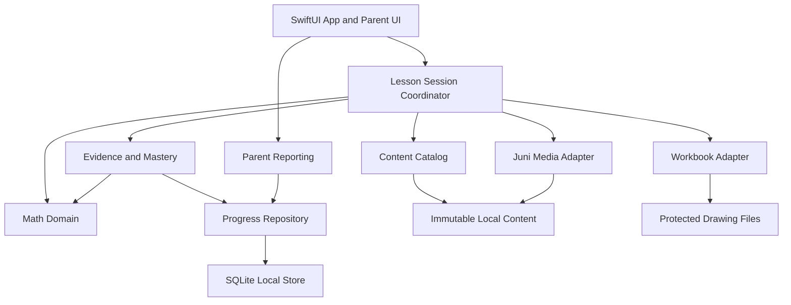

# Singapore Math with Juni — Application Architecture

Version 1.1 • 2026-11-17 • IOS-001 draft for Lead review

## 1. Authority and scope
D01–D13, PROJECT_BLUEPRINT.md and AGENTS.md govern this design. DEVELOPMENT_ROADMAP.md defines task boundaries. The revised objectives.json contains 32 P1 objectives, 65 concepts and 65 lesson slots (59 core, 6 enrichment); coverage-p1.md and first-unit.md guide the beta. CUR-QA-AUDIT.md records internal checks, not independent approval. The uploaded October 2025 MOE syllabus, pp31–32, is the source for P1. Keep original source private; ship original instructional content only. P5/P6 Standard and Foundation must be representable later. First-unit proposal U01–U11 plus optional U12; U07 splitting a whole is the proposed slice. Owner approved unit scope 2026-11-17; independent educational approval remains pending. No runtime AI, account, server, advertisements or mandatory internet. Parent sync, Android, complex expression recognition and full authoring studio are deferred.

## 2. Architecture decisions (proposed unless explicitly approved)
| ID | Decision | Alternatives / validation |
|---|---|---|
| A01 | Native SwiftUI with pure Swift domain packages | Approved platform; modular monolith rather than microservices |
| A02 | iPadOS 17 minimum, current supported Xcode/SDK at build time | Proposed; ENV-001 verifies device and compatible tooling; raise only with rationale |
| A03 | SQLite via GRDB, behind repository interfaces | Proposed dependency; compare native SQLite/SwiftData, license and migration tests before adoption |
| A04 | JSON Codable content, immutable installed packages | Portable to other platforms; DATA-001 owns canonical schema |
| A05 | PencilKit with on-device numeric recognition adapter | Vision spike first; Core ML custom classifier only if needed; no recognition accuracy claim |
| A06 | AVFoundation audio; static SwiftUI mascot fallback; optional Rive adapter | Rive not required for teaching; verify license/runtime before adoption |
| A07 | Single local learner profile for beta, opaque UUID | Schema supports multiple profiles later; no name required |
| A08 | Bundle first unit with app; no network client in beta | Later imports signed packages; sync separate approved design |
| A09 | Swift Testing or XCTest based on toolchain; Python standard tooling for validation | ENV-002 establishes reproducible commands |

## 3. Component model and boundaries

Composition root injects concrete adapters; domain modules never import SwiftUI, PencilKit, GRDB, AVFoundation or networking. UI sends intents and renders immutable view state; grading is never performed in views. Reporting is a read model, never an independent source of mastery. No server endpoint is required for any beta flow.

| Module | Owns | Agent/task |
|---|---|---|
| AppShell | Navigation, profile, dependency assembly, accessibility | IOS-002 |
| LessonRuntime | Reducer, checkpoints, activity registry | IOS-002/006 |
| ContentDomain | Typed IDs, lesson/activity/manifest decoding | DATA-001/002 + iOS |
| MathDomain | Exact answers, seeded generators, equivalence | MATH-001/002 |
| MasteryDomain | Evidence policy, recommendation, review clock | MATH-000/001 |
| MathViews | Counters, ten-frame, order cards, number bonds | IOS-004 |
| Workbook | PencilKit bridge, recognition, keypad, ink persistence | IOS-003 |
| JuniMedia | Local narration/transcripts, character state | IOS-005 |
| LocalStore | Repositories, migrations, atomic writes | DATA-003 |
| ParentFeature | PIN gate, history, controls | IOS-007 |

Suggested repository: app/JuniApp (Xcode target), app/Packages/JuniDomain, app/Packages/JuniInfrastructure, app/Packages/JuniFeatures, app/Tests, curriculum/p1, schemas, tools, assets, audio, docs. Use feature directories initially; separate packages only where dependency direction or testing benefits. LEAD-002 freezes path ownership and contracts before parallel implementation.

## 4. Content and curriculum contract
Catalog hierarchy: level/track → strand → unit → topic → concept → lesson → activity. IDs stable across versions. Official objective IDs are mappings, not lesson IDs. Distinguish core/enrichment and instructional coverage range; U07 evidence within 10 cannot complete an objective through 100. Unit-scoped prerequisite targets resolve to bounded skills; full-range prerequisite graph remains intact. Placement requires equivalent independent evidence; exploration may bypass recommendation, not fabricate mastery. Content authoring uses Python/JSON/Git, later studio.

Proposed illustrative manifest (not canonical DATA-001 schema):
```json
{"schemaVersion":1,"packageId":"p1-unit-01","contentVersion":"1.0.0","locale":"en-SG","level":1,"track":"common","minEngineVersion":1,"lessons":["U07"],"files":[]}
```
Proposed lesson fields: stable id, version, target IDs, objective refs (source ID/page/item), classification, bounded prerequisites, activities with stable IDs, assessment plan, media refs and accessibility text. Activity discriminated union: narration, counters, tenFrame, numeralMatch, orderCards, numberBond, handwriting, keypad, choice, reflection. Each includes teaching phase, interaction constraints, response specification, item family/version, hint sequence, transcript reference, feedback mapping. No arbitrary code, scripts, URLs or executable formulas. Unknown type/version rejects package before activation. Source wording must not be copied into release assets.

Validation: schema, IDs, references, graph cycle detection, numeric bounds, generator support, localization fallback, media existence, rights metadata and SHA-256 integrity. Manifest enumerates file size/hash; validate relative paths, reject traversal/symlinks/duplicates, cap package size. Bundle trust derives from signed app; hashes alone do not authenticate external content. Future downloadable packages require signature verification and trusted key rotation, staged installation and atomic activation. Preserve active version for suspended sessions; failed update leaves previous version usable. No user progress overwritten by content install.

## 5. Lesson runtime
Three pedagogical phases (MOE pp19–20): readiness, engagement, mastery. CPA representations inside engagement as appropriate. State machine: idle → loading → readiness → teaching → guidedPractice → independentCheck → summary → completed; paused/resumable from active phases, recoverableError with retry or safe exit. Enrichment is separately labeled. Each activity has present → interact → submit → evaluate → feedback → advance; uncertain recognition enters confirm rather than evaluate. Independent checks suppress answer-revealing help; requesting a hint converts attempt to assisted, then fresh independent item required.

Reducer inputs: start, contentLoaded, interactionChanged, requestHint, submit, recognitionCandidate, confirmAnswer, feedbackFinished, next, pause, resume, interruption, error. Effects: generate item, play local audio, recognize ink, persist checkpoint, record evidence. Side effects return typed results with session/activity token; stale callbacks ignored. One outstanding submission per item; stable attempt UUID prevents double grading on double tap or restart. Checkpoint after material changes and backgrounding; resume exact item, seed, hint state and current activity. Never block UI on I/O. @MainActor view models; repository and media concurrency isolated; cancellable tasks.

Example U07: readiness count six; Juni directs split into 2 and remaining 4; drag counters into bowls with invariant total unchanged; render corresponding bond; write missing part 4; practice with alternate quantities; independent whole 8/known 3 → 5; explain via drawing or movement. No required formal equation for this introductory slice. Original examples are illustrative, not authored approved content.

## 6. Math and mastery contracts
Conceptual Swift interfaces (not compiled):
```swift
protocol ItemGenerator { func generate(_ request: ItemRequest) throws -> MathItem }
protocol AnswerGrader { func grade(_ answer: Answer, for item: MathItem) throws -> GradeResult }
protocol MasteryPolicy { func evaluate(_ evidence: [Evidence], target: SkillTarget, now: Date) -> MasterySnapshot }
protocol ProgressRepository { func commit(_ outcome: AttemptOutcome) async throws; func snapshot() async throws -> ProgressSnapshot }
```
Use explicit integer/rational values, no floating-point equality for exact answers. Typed answer variants: integer, ordered list, unordered multiset, selection, structured model; text only for approved tasks with explicit normalization. Reject malformed input, out-of-domain operands, ambiguous prompts and division by zero. Version seeded PRNG algorithm (not Swift randomized Hashable), seed plus generator version and parameters persisted; deterministic same input, fresh seeds for new independent checks. Preserve item snapshot for historical grading. Test 0/10 boundaries, equal quantities, all splits, reorder invariance, multiple valid solutions; later ranges/units per objective. No arbitrary expression evaluation.

Evidence fields: UUID, learnerID, targetID, conceptID, objective refs, bounds, itemID/version/seed, attempt ordinal, mode (diagnostic/guided/independent/review), hint exposure, confirmed answer, result, timestamp, content and policy versions. Recognition confidence is UX metadata, not mathematical performance. Invalid/uncertain input and cancellations generate no scored attempt. Report assisted and independent separately; no mastery from repeating exposed answers. Append immutable evidence and derive snapshots transactionally; policy version permits reproducible recomputation.

Moon phases: new = no evidence, crescent = emerging, half = assisted success, gibbous = independent evidence, full = retained independent evidence. Thresholds, sample sizes, review intervals and regression rules deliberately unset pending MATH-000/owner approval. Fixture policy may be injected for engineering tests and explicitly labeled nonproduction. Recommendations prioritize due review and missing bounded prerequisites, then next core target, then enrichment; allow exploration under parent controls. Inject clock, handle timezone/clock changes without punitive mastery loss; never reward speed alone.

## 7. Workbook / recognition
UIViewRepresentable wraps PKCanvasView with coordinator, stable drawing identity and tool selection. Pencil and touch alternatives; avoid conflict between drag manipulatives and drawing by separate interaction zones. Save PKDrawing.dataRepresentation in app-private files; restore safely with error handling, support undo/redo/erase. Preserve free-form working separately from answer box; only crop final answer region for recognizer. Normalize raster contrast/scale; run Vision or local model asynchronously, parse integer within activity bounds. Recognition states idle → processing → candidate/none → confirm/edit/keypad → submitted. Always preview recognized value before grading (even high confidence initially); low confidence offers retry/keypad; never silently grade OCR output. Keypad supports 0–9 and needed multi-digit numbers, clear/backspace/submit; no handwriting requirement for math credit. Number words via separately reviewed tasks, not assumed OCR capability. Store confirmed answer and optional ink reference; never send ink externally. IOS-003 tests synthetic digit samples plus consenting physical stylus trial; report confusion, coverage, latency and fallback usage, no invented accuracy target. Complex equations deferred.

## 8. Juni and audio
JuniPresentation state: idle, explaining, waiting, encouraging, gentleCorrection, celebrating, paused. Map domain events to semantic cue IDs; no scoring in animation. AVAudioPlayer or equivalent local AVFoundation adapter loads validated file, supports replay/mute/pause; synchronize animation approximately with playback events, not live speech synthesis. Audio session interruption/background pauses and resumes at explicit learner action; missing audio → transcript and retry, production package validation rejects missing required assets. Static moon-themed mascot sufficient for fallback; reduced-motion mode; no stars. Narration generated once in development via ElevenLabs after voice/license/budget approval, transcript and media hash recorded. No credentials in app. Voice and transcript review before packaging. Parent controls audio volume/mute; all essential information also visual/textual.

## 9. Storage and recovery
Use Application Support for SQLite and drawings, caches only for regenerable media. Database tables (logical): profiles(id, createdAt); settings(profileID, policy); sessions(id, lessonID, contentVersion, state, checkpoint, revision); attempts(id unique, sessionID, itemSnapshot, targetID, answer, grade, mode, hints, time, versions); mastery(profileID,targetID,policyVersion,snapshot); reviewQueue(profileID,targetID,dueAt); drawings(id, sessionID, relativePath, checksum, revision); installedPackages(id, version, manifestHash, state); migrations(version). Use foreign keys and indexes on profile/target/time and due dates. Transaction commits attempt, derived state and session advancement together. Atomic temp-file rename for drawing before DB reference; clean orphan files after crash, never remove referenced files. Idempotency via unique attempt ID; if commit fails keep submission pending and retry, no duplicate evidence. Migrations transactional with tests from previous fixture; unsupported future versions open safe recovery rather than destructive reset. Keep package version and generator version associated with every attempt.

Use iOS Data Protection for sensitive local files; verify chosen protection class and backup behavior with device tests. Keychain stores parent PIN verifier/secret, not plaintext PIN; rate limit attempts and provide parent-authorized recovery design before release. PIN is a child gate, not a security boundary against device owner. Parent deletion clears local child evidence/drawings with confirmation; exports deferred or parent-only with explicit authorization. No child names in fixtures or logs. No analytics SDK, cloud storage or telemetry for beta. Future opt-in sync uses opaque IDs, versioned event envelopes, idempotent merge of immutable attempts, explicit conflict handling for settings/deletion and consent; no provider or backend selected.

## 10. Parent and accessibility features
Local parent dashboard derives totals from repository: completed sessions vs independent mastery, bounded target progress, recent practice, assistance, review due, recommendation. Do not label partial curriculum as complete. PIN gate exits on background/timeout; child can't change restrictions. Parent controls guided/explore mode, daily goal (not punitive), enrichment, audio and placement reset with confirmation. Remote dashboard deferred. VoiceOver meaningful math labels and focus order, 44pt targets as baseline, Dynamic Type where workable, high contrast, non-color moon labels, reduced motion, replay/transcripts. Drag alternatives via tap-select/tap-place; non-pencil answer path. Clock/ruler/shape components later; physical cm claims require calibration. Adapt iPad layouts to orientation and size; physical unit tests establish real behavior.

## 11. Offline threat model
| Threat | Control / validation |
|---|---|
| Corrupt or malicious content | Strict typed validation, bounds, no execution, path checks, hashes, fail-safe package activation |
| Child accessing parent settings | PIN gate, throttling, inactivity lock, parent confirmation |
| Sensitive data exported accidentally | No transport client, private storage, redacted diagnostics, explicit export gate |
| Crash/restart loses learning | Atomic writes, checkpoint and idempotent attempt commit, migration fixtures |
| Recognition misgrades child | Confirmation and fallback, never score raw OCR |
| Asset or dependency licensing | Rights register, lock versions, dependency review, no unapproved paid assets |
| Tampered future updates | Signed manifest, trust anchor, rollback; not in beta |
| Device loss or clock manipulation | OS protection, honest offline-only recovery limits, robust review dates |

## 12. Acceptance and verification plan
| Requirement | Planned evidence |
|---|---|
| FR01/09 | Supported JSON activity loads without UI code change; invalid schema/graph/media rejected |
| FR02 | Airplane-mode full installed unit including audio and mastery (physical iPad) |
| FR03 | Counter conservation, bond sums, ordering and accessible alternatives |
| FR04/05 | Ink save/erase/reopen, recognition confirmation, keypad parity, interruptions |
| FR06/07 | Seed reproducibility, bounded progression, hint exclusion, retention and exploration fixtures |
| FR08 | Parent-only access; dashboard totals reconcile against evidence |
| FR10 | Kill/restart during submit, migration and duplicate event recovery |
| FR11 | VoiceOver, contrast, reduced motion, target size, transcript and touch alternatives |
| FR12 | Review binary dependencies, no network calls in learner flow, no PII fixtures |

Performance goals (proposed, not measured): responsive 60Hz interactions where hardware permits, local lesson launch under 2 seconds on target device, recognition result/fallback within 2 seconds typical, no main-thread blocking. Measure before setting hard gates. Test matrix: pure Swift domain tests, Python content tests, persistence temp DB tests, UI simulator tests, physical PencilKit/audio/offline tests, independent Education review. ENV-002 supplies actual build/test commands and logs; none run in IOS-001.

## 13. Agent handoffs and implementation order
DATA-001: convert provisional fields into canonical versioned schemas, good/bad fixtures, range-qualified targets; reconcile actual objectives.json vocabulary. MATH-000: define exact evidence transitions, thresholds, seeds, review intervals and assisted rules; obtain owner approval for policy. LEAD-002: freeze contracts and path ownership after IOS-001, DATA-001, MATH-000 acceptance. ENV-001/002: verify actual Codex/Git/Mac/iPad access, toolchain, signing, cost; build skeleton after authorization. IOS-002/003/004/005, DATA-003 and MATH-001 follow roadmap dependencies; parallel branches integrate via agreed fixtures. EDU-001 authors U07 only after CUR-003 and DATA-001 accepted. IOS-006 integrates slice; IOS-007 parent reporting; QA-001 independent review before expansion. Do not bypass dependency gates; preparatory drafts are not acceptance.

## 14. Review checklist and open issues
Lead checks module boundaries, state transitions, deployment target proposal, offline threat model, FR coverage and consistency with DATA-001/MATH-000. Independent educational approval of CUR-001/002/003 remains pending per audit. First-unit bounded targets must be formalized before implementation. Confirm device OS/stylus compatibility, actual recognition performance, migration strategy, dependency licenses, content rights and voice costs. A local bootstrap repository and toolchain smoke test are documented in environment.md; no external agents, native build or device verification performed. Scope and approved D01–D13 unchanged; all reversible implementation choices above are proposals. IOS-001 remains review until Lead checks and contract reconciliation; final freeze under LEAD-002.
