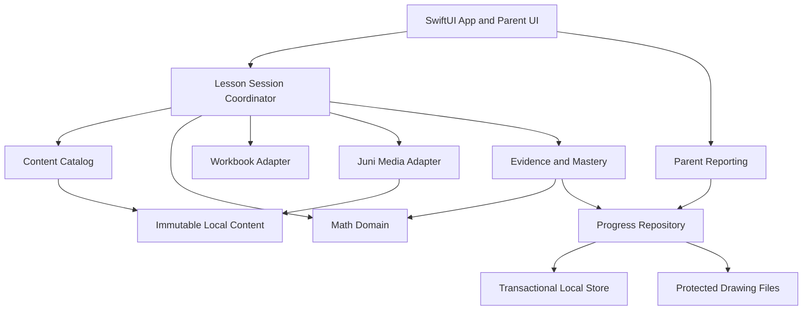

# Singapore Math with Juni — Application Architecture

Version 1.3 • 2026-11-19 • IOS-001 reviewed document baseline; interface reconciliation pending

## 1. Authority and scope
D01–D13, PROJECT_BLUEPRINT.md and AGENTS.md govern this design. DEVELOPMENT_ROADMAP.md defines task boundaries. The revised objectives.json contains 32 P1 objectives, 65 concepts and 65 lesson slots (59 core, 6 enrichment); coverage-p1.md and first-unit.md guide the beta. CUR-QA-AUDIT.md records internal checks, not independent approval. The verified October 2025 MOE syllabus, pp31–32, is the source for P1. Keep original source private; ship original instructional content only. P5/P6 Standard and Foundation must be representable later. First-unit proposal U01–U11 plus optional U12; U07 splitting a whole is the proposed slice. Owner approved unit scope 2026-11-17; independent educational approval remains pending. No runtime AI, account, server, advertisements or mandatory internet. Parent sync, Android, complex expression recognition and full authoring studio are deferred.

The owner-approved PD-01–20 extend D01–D13. Integration inputs are pinned to design revision `bd0483fa938f546675b5e7ede7485ba10d313990`. [Product design](https://github.com/binbas0901/Singapore-math-with-Juni/blob/bd0483fa938f546675b5e7ede7485ba10d313990/docs/PRODUCT_DESIGN.md) · [Home brief](https://github.com/binbas0901/Singapore-math-with-Juni/blob/bd0483fa938f546675b5e7ede7485ba10d313990/docs/design/HOME_SCREEN.md)

| Gate | Delivery boundary |
|---|---|
| U07 slice | Compact teacher header, local narration and transcript, deterministic split with teaching hand or static steps, counters and number bond, guided and fresh independent work, focused ink and keypad, reflow, resume and protected basic reporting. Development fixtures may use placeholder media. QA-001 and owner slice acceptance gate expansion. |
| First-unit private beta | Entire approved 0–10 unit after curriculum gates, approved local media, unit-required tools, guided progression, allowed exploration, independent practice, bounded placement with skip/override, retention review, local parent reporting/settings and physical-device/offline evidence. Home projects resume and next eligible work. Workbook supports focused working and the same per-item contract for independent practice sheets. Lead reconciles minimum sheet presentation, plan depth and enabled routes at integration within the existing IOS-008 commitments. |
| Broader product | P1–P6 and distinct tracks, expanded Math Lab and tool catalog, richer sheets, broader diagnostics and daily planning, parent assignments/analytics, Garden decorations and advanced enrichment. Complex handwriting, studio, signed downloads, cloud sync and public release have separate gates. |

Use PD-06's flexible 10–15 minute design target, which supersedes the first-unit draft's 8–12 minutes. Readiness, breaks and evidence can change session length. Timing has no grading role.

## 2. Architecture decisions (proposed unless explicitly approved)
| ID | Decision | Alternatives / validation |
|---|---|---|
| A01 | Native SwiftUI with pure Swift domain packages | Approved platform; modular monolith rather than microservices |
| A02 | iPadOS 17 minimum, current supported Xcode/SDK at build time | ENV-002 scaffold declares 17; verify minimum-OS runtime, target Pencil compatibility and signing before release |
| A03 | Transactional local store behind repository interfaces | DATA-003 compares native SQLite, SwiftData and GRDB using transaction, migration, licensing and maintenance evidence |
| A04 | JSON Codable content, immutable installed packages | Portable to other platforms; DATA-001 owns canonical schema |
| A05 | PencilKit with on-device numeric recognition adapter | Vision spike first; Core ML custom classifier only if needed; no recognition accuracy claim |
| A06 | AVFoundation clock with typed deterministic cues; native SwiftUI presentation | Validate native prototype and reduced-motion path before considering a third-party runtime |
| A07 | Single local learner profile for beta, opaque UUID | Schema supports multiple profiles later; no name required |
| A08 | Bundle first unit with app; no network client in beta | Later imports signed packages; sync separate approved design |
| A09 | Swift Testing or XCTest based on toolchain; Python standard tooling for validation | ENV-002 establishes reproducible commands |

## 3. Component model and boundaries

Composition root injects concrete adapters; domain modules never import SwiftUI, PencilKit, GRDB, AVFoundation or networking. UI sends intents and renders immutable view state; grading is never performed in views. Reporting is a read model, never an independent source of mastery. No server endpoint is required for any beta flow.

| Module | Owns | Agent/task |
|---|---|---|
| AppShell | Navigation, profile, dependency assembly, accessibility | IOS-002 |
| LessonRuntime | Reducer, checkpoints, activity registry | IOS-002/006 |
| ContentDomain | Typed IDs, lesson/activity/manifest decoding | DATA-001/002 + iOS |
| MathDomain | Exact answers, seeded generators, equivalence | MATH-001/002 |
| MasteryDomain | Evidence policy, recommendation, review clock | MATH-000/001 |
| MathViews | Counters, ten-frame, order cards, number bonds | IOS-004 |
| Workbook | PencilKit bridge, recognition and keypad; LocalStore owns durable ink | IOS-003 |
| JuniMedia | Local narration/transcripts, character state | IOS-005 |
| LocalStore | Repositories, migrations, atomic writes | DATA-003 |
| ParentFeature | PIN gate, history, controls | IOS-007 |

Use the ENV-002 paths [app/Juni](../app/Juni), [app/JuniCore](../app/JuniCore) and [app/JuniUITests](../app/JuniUITests). Keep pure math, tool state and policy testable in Swift without iOS frameworks. Begin with feature directories and extract packages only for a concrete dependency or test boundary. LEAD-002 freezes ownership and interfaces.

### Shared mathematical tools (M1)

`ToolState.applying(MathAction, under: InteractionRules) -> Result<ToolState, InvalidAction>` is a pure Swift boundary. Native views render immutable state and emit the same semantic actions from drag, tap-select/place and VoiceOver. Start with U07 counters and number bonds, then add the tools required by the approved unit. Counter IDs are unique and belong to exactly one region, including the source tray. Moves conserve the whole, empty parts represent zero and committed parts sum to the whole. Reset returns an explicit validated baseline. Invalid actions leave state unchanged. Bond and counter views project the same partition when displaying a linked model.

The session supplies demonstration, guided or free-exploration rules. A demonstration folds its own actions over a separate model. Lab and exploration may reuse the domain and renderer. Only the lesson assessment handler can create scored evidence. Keep authoring to typed actions and add tools as curriculum requires them.

## 4. Content and curriculum contract
Catalog hierarchy: level/track → strand → unit → topic → concept → lesson → activity. IDs stable across versions. Official objective IDs are mappings, not lesson IDs. Distinguish core/enrichment and instructional coverage range; U07 evidence within 10 cannot complete an objective through 100. The accepted CUR-002 inventory distinguishes three relationships: advisory core slot order; task-bounded readiness probes for the quantities and representations in the task (equivalent evidence or scaffolding supports entry and exploration); and genuine component-skill mastery prerequisites, established by prior or concurrent independent evidence. Objective-level links summarize concept dependencies and never require full mastery of every linked objective. For U07, count and match six as an entry probe, then check or support counting within the range needed for the next task, including eight. Comparison, ordering, spelling, handwriting and full-range mastery are not U07 prerequisites. Placement recommendations and parent overrides may change navigation but cannot establish mastery; waiving guided instruction requires equivalent independent evidence for its bounded target. Content authoring uses Python/JSON/Git, later studio.

Proposed illustrative manifest (not canonical DATA-001 schema):
```json
{"schemaVersion":1,"packageId":"p1-unit-01","contentVersion":"1.0.0","locale":"en-SG","level":1,"track":"common","minEngineVersion":1,"lessons":["U07"],"files":[]}
```
Proposed lesson fields: stable id, version, target IDs, objective refs (source ID/page/item), classification, separate advisory sequence, bounded readiness and component mastery prerequisite references, activities with stable IDs, assessment plan, media refs and accessibility text. Activity discriminated union: narration, counters, tenFrame, numeralMatch, orderCards, numberBond, handwriting, keypad, choice, reflection. Each includes teaching phase, interaction constraints, response specification, item family/version, hint sequence, transcript reference, feedback mapping. No arbitrary code, scripts, URLs or executable formulas. Unknown type/version rejects package before activation. Source wording must not be copied into release assets.

Validation: schema, IDs, references, graph cycle detection, numeric bounds, generator support, localization fallback, media existence, rights metadata and SHA-256 integrity. Manifest enumerates file size/hash; validate relative paths, reject traversal/symlinks/duplicates, cap package size. Bundle trust derives from signed app; hashes alone do not authenticate external content. Future downloadable packages require signature verification and trusted key rotation, staged installation and atomic activation. Preserve active version for suspended sessions; failed update leaves previous version usable. No user progress overwritten by content install.

## 5. Lesson runtime and ownership (H2)

A profile-scoped coordinator at app composition owns the single writable lesson session across SwiftUI navigation, orientation, layout and scene rebuilds. Views bind by session and activity identity. One foreground scene holds the interaction lease; another can show read-only resume status. Explicit takeover seals the old scene's input and saves or resolves its latest transitions before issuing a new lease epoch. If that drain fails, show recovery and keep the second scene read-only. Late intents carry the old epoch and are discarded.

Use a serialized reducer per session with ordered intents and versioned effects. The reducer applies each event synchronously to in-memory state; platform effects finish asynchronously and reenter as events. A single ordered writer fences checkpoint updates with expected revision and lease. No reentrant async method may assume state survived an await. Domain state contains no view, canvas or audio player instances.

Lesson progression is readiness → teaching → guided practice → independent check → summary → completed. Activities move through present/observe → interact → confirm if needed → pending submission → committed feedback → next. Pause overlays a resumable state. Recoverable errors preserve the last durable state. Replays and optional exploration use their own presentation state. Readiness, engagement and mastery follow the pedagogical sequence as appropriate.

`SessionCheckpoint` contains schema and reducer version, profile/session IDs, monotonic revision, pinned package/version/hash and locale, lesson/activity and item occurrence IDs, immutable item snapshot and generator ID/version/seed/parameters, phase and return phase, learner model and draft/confirmed response provenance, assistance stage and exposures, latest durable ink revisions, clip/step and position, pending submission or committed feedback receipt and the next cursor. Store semantic state only. Navigation may reconstruct the last active route from the checkpoint. A published revision is the recovery boundary.

| Event | Transition and recovery |
|---|---|
| Rotation / size change | Rebind layout, semantic anchors and canvas transforms to the existing coordinator. Preserve the player clock, active item, tool state, redo history, draft and feedback. |
| Back / leave | Pause media, invalidate recognition, seal input and flush completed strokes and checkpoint before releasing the writable scene. If saving fails, surface retry and keep the draft available. Returning resumes the same activity. |
| OS interruption / background | Pause at sampled media position; suspend interaction as appropriate and request a checkpoint. Reject invalidated recognition results. Resume playback explicitly. An OS kill may lose a stroke in progress or edits newer than the last durable checkpoint. |
| Relaunch | Read latest durable revision, resolve pending submission via §9, reopen ink, reconstruct the demonstration at saved position paused, clear transient recognition and selection handles. Committed feedback may be displayed again from its receipt. |
| Installed content changed | Resolve pinned version/hash or apply a reviewed compatible migration. If unavailable, park the session and keep ink/evidence accessible to authorized reporting. Offer a separate restart on installed content. Never substitute a new question under the old attempt. |
| Corrupt checkpoint / missing referenced ink | Surface a recovery state, preserve committed evidence and original references, and offer safe resume from a verified compatible checkpoint where available. No silent fallback to another drawing or score. |

All item events include session/activity/item identity. Recognition adds ink revision, answer region and request epoch (§7). Media adds playback epoch and clip version (§8). Duplicate or stale completions leave state unchanged. A pending submission locks mutations to its response, assistance and captured ink. Accept feedback/advance only against a committed receipt, and make Next revision-checked so duplicate intents cannot skip a question.

## 6. Math, assistance and mastery contracts (H3)

Proposed pure Swift interfaces. Canonical types and policies are subject to reconciliation.

```swift
protocol ItemGenerator { func generate(_ request: ItemRequest) throws -> MathItem }
protocol AnswerGrader { func grade(_ answer: Answer, for item: MathItem) throws -> GradeResult }
protocol AssistancePolicy { func next(_ context: AssistanceContext) -> AssistanceTransition }
protocol MasteryPolicy { func evaluate(_ evidence: [Evidence], target: SkillTarget, now: Date) -> MasterySnapshot }
```

Use exact integer/rational arithmetic, typed answers and explicit equivalence. Reject malformed and ambiguous items, division by zero and out-of-domain operands. Version the deterministic PRNG algorithm and generator parameters. Persist the original snapshot for audit and recovery. A canonical exposure key identifies mathematically equivalent presentations of the same question/answer relationship within the bounded target and family. It accounts for authored equivalences such as reordered interchangeable parts. Cosmetic changes and fresh seeds can reproduce an exposed key.

Policy input includes bounded target, requested mode, item occurrence and exposure key, ordered exposures for the learner/target, confirmed mathematical error, prior evidence and authored available branches. Before offering an item, resolve its eligibility. Seal exposure when the reducer selects help for delivery. Publish the exposure durably before releasing the associated visual or audio content, and block submission until that barrier resolves. A crash at that barrier may conservatively retain an exposure awaiting delivery. Restore the selected assistance variant with the item. An unopened hint request does not alter eligibility. Evaluate committed feedback and prior exposure before a new attempt. For a matching confirmed error and context, choose the first eligible authored rung in order: neutral retry, representation hint, guided action, reteach. Use the generic branch when no reviewed error mapping matches. Persist the chosen rung so replay cannot climb the ladder. Persist assistance stage across retries and retain relevant exposures across sessions within the policy's scope.

| Trigger / precondition | Reducer outcome and evidence |
|---|---|
| Neutral retry after confirmed error | Offer another response with no solution information. Preserve prior exposure status and attempt ordinal. Independent eligibility remains subject to MATH-000 retry rules. |
| Accessibility control, caption of existing prompt, confirmed transcription or keypad without new math information | Preserve eligibility. Judge neutrality against the measured skill. Reading directions aloud can be neutral in a counting task, while reading a target number word supplies the skill being assessed. An answer-revealing caption or replay carries the same exposure as the equivalent spoken or visual help. Recognition uncertainty, cancellation and invalid input create no scored evidence and cannot advance assistance. |
| Representation hint delivered | Record exposure before enabling submission. Mark the item assisted and offer the authored visual representation. Select a specific mapping only for an educator-reviewed error match, otherwise use generic support. |
| Guided action delivered | Record the action scaffold and retain assisted eligibility for the current question. Grade only the child's confirmed submission. |
| Reteach or worked example delivered/replayed | Register the disclosed question keys, including solution-revealing feedback. Demonstration actions and replay themselves create zero attempts. An already committed score keeps its pre-feedback evidence class. Repeating exposed questions stays assisted. |
| Assisted success or reteach completes | Offer a fresh unexposed item for the same bounded target with equivalent demand and required representation constraints. Select deterministically from eligible candidates. If exhausted, finish as practice with independent check pending. |
| Independent response submitted | Freeze exposure and eligibility at submit. Record independent evidence only for an eligible question under the policy, with no applicable disclosure. Guided success stays guided even when the answer is correct. |
| Placement recommendation, skip or parent override | Keep diagnostic mode and recommendation distinct from mastery. Record provenance of manual placement and derive no mastery from skip/override. Parent-selected or diagnostic start recommendations may change browsing or the offered check. Waiving prerequisite instruction in the guided path requires equivalent independent evidence, as specified by the first-unit proposal. |
| Retention review | Require a due target and a fresh eligible independent check under the policy. Assisted review can guide remediation. Lab, demonstration, completion and elapsed time create no mastery evidence. |

Evidence includes submission ID, learner/session/item occurrence and exposure key, target/concept/source refs and bounds, generator ID/version/seed/parameters, attempt ordinal, requested mode (diagnostic/guided/independent/review), actual evidence class, ordered assistance references, confirmed answer, exact grade, timestamp, content and policy versions. Recognition confidence is UX metadata. Evidence is immutable. Parent reporting derives completion, guided work, independent success and retention from their own records.

Moon labels pair a non-color text label with their evidence stage. New means no evidence, crescent emerging, half assisted, gibbous independent and full retained. Education and MATH-000 define exposure equivalence and scope, retry eligibility, thresholds, diagnostic cutoffs, review intervals, regression and misconception mappings. Owner approval is needed for learning policy. Use explicitly nonproduction fixture policy in integration tests. Prioritize due review, suggest bounded readiness support and then eligible core work and optional enrichment. Advisory order and readiness probes never lock exploration or independent mastery; only genuine component-skill requirements affect mastery eligibility, with prior or concurrent independent evidence as allowed by CUR-002. Inject a clock and handle changes without punitive loss.

## 7. Workbook and revision management (M3, H2)

Focused lessons and sheets share `WorksheetID / ItemOccurrenceID / AnswerRegionID` and the same submission handler. A sheet virtualizes rendering and loads visible drawings on demand. Keep stable logical ink coordinates and region bounds, with a reversible viewport transform for rotation, zoom and crop. Scratch work, answer-region ink, recognition candidate and confirmed typed answer are distinct. Wrap PencilKit in a native bridge and keep undo/redo history owned by the live item workspace across reflow. After process restart, reopen the durable drawing with an empty undo stack. Undo, redo and erase create new revisions, including an explicit empty drawing for erase. Test left/right-handed tool placement and touch/keypad parity.

Assign an immutable revision ID when a stroke edit is captured. Begin recognition against a snapshot tagged with lease/session/activity/item, region, revision and request epoch. Editing the relevant ink, erase, undo, changing item, choosing keypad or superseding a request invalidates candidate and pending OCR results. A confirmed OCR response retains source revision and is invalidated by subsequent changes to its answer ink before submit. A separately entered keypad response has its own provenance. Reflow alone leaves identity and revision intact. Recognize only the answer region on-device. Preview all candidates for explicit confirmation/edit; otherwise offer retry/keypad. No arbitrary working interpretation.

Persist revised drawing bytes before publishing a reference (§9). On submit, capture the exact answer and referenced revision plus the latest completed working, flush them through the writer, then durably prepare the submission. Ink saved later cannot replace bytes referenced by a pending or committed attempt. On write failure retain the editable draft or the prepared submission according to the durable boundary, and show retry. IOS-003 measures supported numerical coverage, confusions, latency and fallback on synthetic samples and an authorized Pencil trial. Complex expressions are deferred.

## 8. Deterministic narration and demonstration (H1, M2)

`ClipTimeline` identifies the versioned local clip by package, asset ID, locale and hash. Its ordered cues have stable IDs, integer offsets from clip start, tie-break ordinals and typed payloads. Payloads are either mathematical actions (for example, move named counters from tray to bowl) or presentation updates (highlight, hand pose, caption chapter). DATA-001/002 validate unique IDs, ordering, duration bounds, semantic targets, baseline and action legality through the complete fold. Keep transcripts, timing, locale, rights and hash in the local package. Captions and step text preserve the teaching meaning.

`project(timeline, baseline, position) -> DemoState` folds cues from the immutable baseline through all offsets less than or equal to the sampled position in canonical order. Between cues the renderer may interpolate geometry. Mathematical state changes only at cue boundaries. Use the AVFoundation player's position as source of truth, including after a missed tick. Play, replay, seek and restoration use the same projection. Replay starts at time zero under a new playback epoch. Ignore samples, completion and interruption callbacks for superseded epochs or clip versions. Rotation changes semantic-anchor geometry while the active clock continues. Explicit pause and OS interruptions sample and hold position. Relaunch reconstructs the position paused. End of clip lands on the final state and exposes the same explicit Try action as the last step.

Observe locks conflicting learner edits. Try transitions once to an authored valid learner baseline, independent of the demonstration's final position. Reopening a demonstration from Try preserves the learner workspace and returns to it, including ink and draft. If the demonstration reveals applicable help, route through the exposure barrier in §6 before display. Media events cannot submit, grade or advance an assessment. Muted narration, missing or failed playback and reduced motion offer a complete manual chapter/step sequence using the same cue boundaries and math projection. Preserve position when switching to manual steps so the learner can continue without hearing audio. A step traverses to a chapter boundary with all intervening actions folded.

Presentation derives speaking from actual audible playback and thinking, waiting, encouragement, correction, celebration or attention from semantic events. No microphone. A reusable teaching hand takes semantic anchors and move/point/contact/release states. Resolve anchor geometry at render time. Keep targets visible and provide a static highlight and text equivalent. Prototype with native SwiftUI before considering another animation runtime. Moon-only identity and compact header apply in both orientations. Voice and tactile SFX have independent controls. Suppress nonessential tactile effects while narration speaks. CREATIVE-001 and IOS-005 require owner-reviewed hand/character assets, voice samples, commercial rights and approved spend for production ElevenLabs narration.

## 9. Local persistence and recovery (H2, M5)

Logical records include profile/settings, session checkpoints, immutable ink metadata, prepared submissions, committed receipts/evidence, derived mastery/review state, installed package versions and migrations. Use foreign keys or equivalent constraints and index catalog and evidence lookups by stable IDs, learner/target/time and review due date. Load active assets and drawings on demand. DATA-003 compares store candidates against migrations and transaction/crash fixtures.

Proposed repository operations are `publishCheckpoint(expectedRevision, lease, checkpoint)`, `prepareSubmission(expectedRevision, lease, payload)` and `commitSubmission(submissionID) -> CommitReceipt`. A payload freezes session/item/checkpoint identity, attempt ordinal, confirmed answer and provenance, exact ink references, assistance, target, original item snapshot, grading and policy versions and a stable evaluation time.

1. Assign one submission ID per accepted submit intent. Seal the item and flush the captured ink before preparing. Store each drawing at a new immutable path via same-directory atomic publication, with length/hash validation and durability ordering before committing its database reference. A referenced file is never overwritten. DATA-003 verifies sync and restart ordering on-device for the selected storage mechanism.
2. Transactionally persist the pending payload and matching pending checkpoint using the expected revision. Enforce unique submission ID and unique session/item occurrence/attempt ordinal. Double taps reuse the pending operation. A repeated ID with a different payload is an integrity error.
3. Grade deterministically from the prepared payload. In one transaction insert immutable outcome/evidence, update derived mastery and review state, record the receipt, clear pending and persist committed feedback plus the next cursor. Within the serialized transaction, look up an existing receipt first and return it verbatim. Recompute derived state from committed evidence plus the new outcome under the recorded policy, using the frozen evaluation time. The visible feedback checkpoint holds the submitted item while the cursor points to its successor or terminal state.
4. On relaunch before prepare, reopen the latest durable draft and require a new explicit submit. After prepare and before commit, recover and complete the same submission. After commit even if the reply was lost, restore committed feedback with the same receipt and advancement. A corrupt/missing dependency or unsupported policy version parks pending work for recovery and leaves prior committed history intact. No partial score is visible. Recoverable store failures keep pending work retryable.
5. Serialize reference publication and cleanup. Sweep orphan temporary/final files only after reconciling durable references from checkpoints, pending submissions, attempts and saved work, with in-flight writes protected. A failed prepare may leave an orphan. A later ink save or erase never removes bytes still referenced by evidence.

**Data protection and restore.** Classify ink, answers, evidence, drafts, placement, derived reports and learner preferences as private learner data. Store under protected Application Support, including database sidecars and staging files. Proposed beta policy excludes these from OS backups and keeps sensitive preferences in the protected store. Bundle assets are replaceable and caches disposable. Treat a missing verifier or inconsistent restored profile as locked; provide an owner-approved local parent recovery flow before release, with no automatic unlock or plaintext PIN. A new install starts with an empty profile. Verify file protection, backup/restore and unavailable protected-data behavior on device.

**Parent access and purge.** Use Keychain for a verifier/secret with device-local accessibility and durable retry throttling across process restarts, including conservative handling of clock rollback. Expire parent access on background and after an inactivity window, clear sensitive views, and cover learner work and parent data in app-switcher snapshots. This gate controls child access; OS Data Protection governs device storage. For confirmed deletion, durably mark a purge in progress, seal writers and hide the profile, remove evidence, ink including orphans, checkpoints, placement, learner settings, derived data and caches, then finalize the tombstone. Relaunch resumes a pending purge before exposing a profile. Include database sidecars and any sensitive caches in the deletion design. Verify logical deletion and interruption recovery with synthetic data. Public distribution, export and any cloud design require their own privacy review.

## 10. Parent and accessibility features
Local parent dashboard derives totals from repository: completed sessions vs independent mastery, bounded target progress, recent practice, assistance, review due, recommendation. Do not label partial curriculum as complete. PIN gate exits on background/timeout; child can't change restrictions. Parent controls guided/explore mode, daily goal (not punitive), enrichment, audio and placement reset with confirmation. Remote dashboard deferred. VoiceOver meaningful math labels and focus order, 44pt targets as baseline, Dynamic Type where workable, high contrast, non-color moon labels, reduced motion, replay/transcripts. Drag alternatives via tap-select/tap-place; non-pencil answer path. Clock/ruler/shape components later; physical cm claims require calibration. Adapt iPad layouts to orientation and size; physical unit tests establish real behavior.

### Home projection and navigation (M4)

`projectHome(snapshot, availability, parentSettings, now) -> HomeState` is a local read projection. Distinguish loading, no plan, resume, review due, planned work, unit complete, unavailable content and recoverable storage failure. Resume takes priority. Eligible work can include ordered review, learn, independent practice and optional challenge, with estimated durations. Recompute unstarted work on date or clock changes, evidence, setting changes and installed-content changes. Midnight and plan refresh preserve the active session. A parent restriction blocks newly disallowed routes and pauses any now-disallowed session at a durable checkpoint until it is permitted again or the learner chooses available work.

Home, Explore, Math Lab, Workbook and Garden share stable route identity across orientation. Route availability derives from installed content, implemented features and parent permissions. Withhold or clearly label unavailable destinations. Parents opens separately behind the gate. Keep art separate from live controls and verify depicted math with Education. The referenced PNG is outside Git. Obtain it and the reviewed Home/U07 storyboard and component designs before production UI. Use accessible native controls in both layouts.

## 11. Offline threat model
| Threat | Control / validation |
|---|---|
| Corrupt or malicious content | Strict typed validation, bounds, no execution, path checks, hashes, fail-safe package activation |
| Child accessing parent settings | PIN gate, throttling, inactivity lock, parent confirmation |
| Sensitive data exported accidentally | No transport client, private storage, redacted diagnostics, explicit export gate |
| Crash/restart loses learning | Atomic writes, checkpoint and idempotent attempt commit, migration fixtures |
| Recognition misgrades child | Confirmation and fallback, never score raw OCR |
| Asset or dependency licensing | Rights register, lock versions, dependency review, no unapproved paid assets |
| Tampered future updates | Signed manifest, trust anchor, rollback; not in beta |
| Device loss or clock manipulation | OS protection, honest offline-only recovery limits, robust review dates |

## 12. Acceptance and verification plan
| Requirement | Planned evidence |
|---|---|
| FR01/09 | Supported JSON activity loads without UI code change; invalid schema/graph/media rejected |
| FR02 | Airplane-mode full installed unit including audio and mastery (physical iPad) |
| FR03 | Counter conservation, bond sums, ordering and accessible alternatives |
| FR04/05 | Ink save/erase/reopen, recognition confirmation, keypad parity, interruptions |
| FR06/07 | Seed reproducibility, bounded progression, hint exclusion, retention and exploration fixtures |
| FR08 | Parent-only access; dashboard totals reconcile against evidence |
| FR10 | Kill/restart during submit, migration and duplicate event recovery |
| FR11 | VoiceOver, contrast, reduced motion, target size, transcript and touch alternatives |
| FR12 | Review binary dependencies, no network calls in learner flow, no PII fixtures |

### Shared verification fixtures

| Fixture | Observable result and owner |
|---|---|
| U07 timeline, synthetic times 0/1/2/3/4 s with six named counters | Match the CUR-003 storyboard at `e37801e9b6fa07c5423e2d90558cee74a29662a5` (Education re-review pending). At 0 s all six are in the source tray, part roles unassigned. Move C1 to bowl A at 1 s and C2 at 2 s. At 3 s explicitly assign the tray the visible and accessible role of part B (no counter duplication or move); display linked bond whole 6, part A 2, part B 4, with each counter in exactly one location. At 4 s return C1 and C2 to the tray in ordered same-boundary actions, clear the active partition and verify all six recombined; retain the explained bond as a separately labeled completed example. Counts (tray,bowl) at 0/1/2/3/4 s are (6,0), (5,1), (4,2), (4,2), (6,0). Sample before/at/after boundaries, skip ticks, pause, rotate, interrupt, replay, recover paused and manually step through mute/failure. Tie order yields identical fold on seek and sequential playback; old callbacks have no effect. Try begins at a separate authored guided baseline of seven, known part one; replay preserves learner work and produces zero attempts. Fresh independent whole 8, known part 3 leaves missing 5 undisclosed; allow learner-selected modelling or explanation. DATA-001/002, IOS-004/005, IOS-006 and QA-001. |
| U07 tool operations including zero, reset and invalid move | Drag, tap and VoiceOver yield the same state. Zero is representable, each counter has one location, linked bond agrees, reset restores baseline and illegal moves leave state intact. IOS-004 and Education. |
| Two scenes and revisions R1/R2, including empty R2 | Rotate during drawing and recognition, erase or undo during recognition, then deliver the stale result. Preserve undo history across reflow and reject stale candidates. Verify correct crop and durable empty drawing after restart. Transfer scene ownership and reject stale lease inputs. IOS-002/003 and DATA-003. |
| Crash/failure matrix at file publication, prepare, commit and reply | Before prepare reopen durable draft without scoring. Prepared attempt recovers once at the same ink revision. After commit and lost reply, get one score, the same receipt and cursor. Referenced revisions survive cleanup and orphans are reclaimable. Rotate during feedback and send duplicate Next; advance once. Pin compatible content or park on mismatch. DATA-003 and QA-001/002. |
| Evidence eligibility using illustration whole 6 / known 2, later whole 8 / known 3 | A response of 4 for the shown 6–2–4 example stays assisted. The authored guided follow-up should use a different split; the runtime fixture exercises the exposed-item guard. Worked example replay and a regenerated equivalent question cannot earn independent evidence. Fresh independent 5 can under fixture policy. Caption of prompt and confirmed keypad/OCR remain neutral. Ambiguous errors route to generic help. Skip/manual placement and Lab produce no mastery; an eligible due retention check can provide retention evidence. MATH-000/001 and EDU-001. |
| Home availability and profile recovery | Exercise review due, interrupted session across midnight, restricted exploration, no plan, unavailable content and unit complete. Test throttle across process restart, parent lock/background, missing verifier, migration from previous fixture and crash during purge. Reports reconcile exactly to synthetic attempts. IOS-002/007/008 and DATA-003. |

### Device and scale gates (M6)

QA-001 and QA-002 record device/Pencil and OS, build/package IDs, workload and measurement method. Run cold lesson load, peak memory, stroke-to-render latency, cue drift and recognition turnaround during representative drawing, reflow, playback and rendering on the target iPad. Include minimum-OS runtime, VoiceOver focus/actions, larger text, both orientations, reduced motion, contrast, captions and full installed-unit completion in airplane mode. Record distributions and fallback incidence for recognition with synthetic input. Establish release budgets from target-device measurements and representative media. Earlier 60 Hz and two-second launch/recognition figures are provisional design goals.

DATA-002/004 validate representative P1–P6 package fixtures, including Standard and Foundation track identity, core/enrichment separation, acyclic qualified prerequisites, bounded exact arithmetic and historical generator compatibility. This is a scalability test, with wider curriculum production following its own roadmap. Start with indexed lookups and lazy asset/drawing loading. Release verifies signing and supported physical iPad/Pencil. ENV-002 records simulator build and launch/rotation evidence for the scaffold. Minimum-OS runtime, physical tests and workload measurements remain open.

## 13. Handoff and open decisions

CUR-001 source and CUR-002 inventory are Lead-accepted and integrated. Follow CUR-003 independent Education review for unit sequencing and bounded targets before downstream lesson work. ENV-002 is accepted and integrated, with current paths in §3. LEAD-002 freezes interfaces only after IOS-001 re-review and reconciliation with DATA-001 and MATH-000. Follow roadmap dependencies for EDU-001, IOS-002–007, DATA-002/003 and MATH-001. QA-001 and owner slice acceptance precede full-unit expansion. [Lead status](PROJECT_STATUS.md) · [ENV-002 evidence](qa/env-002.md)

| Decision owner | Required resolution |
|---|---|
| DATA-001 with iOS and Education | Canonical typed cue payloads and timebase, semantic targets and chapter/fallback format; worksheet identities; bounded skill and exposure references; authored assistance variants; snapshot/version compatibility and validation fixtures. |
| MATH-000 with Education | Exposure equivalence, propagation and eligibility for retries, equivalent fresh items and retention; deterministic error/assistance routing; diagnostic evidence conversion rules, placement cutoffs, thresholds, review schedule and historical policy compatibility. Resolve against shared U07 fixtures before freeze. |
| DATA-003 with iOS and Release | Store selection, file durability and migration semantics, protection/backup behavior, throttle and purge recovery. Evaluate platform capabilities on device. Review dependency licensing and maintenance before adoption. |
| Lead and owner | Lead reconciles minimum workbook, Home and enabled navigation at the existing beta gate. Preserve placement and retention. Any change to approved scope needs owner authorization. Owner approves learning policy, production visual designs, character/hand, voice and licensing/budget, private-beta recovery policy and distribution. |

## 14. Independent review disposition

| Finding | Revision disposition |
|---|---|
| H1 | §8 specifies versioned clock projection, isolated demonstration state, explicit Try and equivalent manual steps. |
| H2 | §§5, 7 and 9 specify one session writer, effect fences, frozen submissions and ink/transaction recovery. |
| H3 | §6 specifies ordered exposure, eligibility, deterministic routing and placement/retention evidence. |
| M1 | §3 assigns tool state and legal actions to pure Swift, accessible rendering to native UI and scoring to assessment. |
| M2 | §8 assigns expressive presentation, reusable hand and tactile audio to local adapters. Native and reduced-motion validation remains downstream. |
| M3 | §7 defines shared focused/sheet item storage, coordinate transforms, history and recognition boundaries. |
| M4 | §10 specifies Home projection, orientation-stable routes and feature availability. Lead reconciles delivery depth. |
| M5 | §§9–10 specify protection, restore, parent locking and resumable purge. Store and recovery details await DATA-003 and owner review. |
| M6 | §12 specifies device/workload and scale fixtures. Physical measurements remain downstream. |
| L1 | §§3 and 13 anchor scaffold paths and accepted dependencies, with remaining gates explicit. |
| L2 | §§1 and 10 record the timing supersession and the visual/storyboard dependency. |

IOS-001 remains in review until DATA-001 and MATH-000 reconciliation. The tables specify proposed contracts and planned verification. Independent re-review completed; the Lead addressed the two remaining document corrections below. Runtime and physical-device implementation evidence remain downstream. [Independent findings](qa/ios-001-independent-review.md)

## 15. Independent re-review closure — document level

The [independent re-review](qa/ios-001-final-review.md) at `6d656d7ef9a4e905985e1c347be23fe5f1b27673` reviewed architecture v1.2 (`9691d4a3af2f514c9afac32e0642e79972a561fa`). R1 is addressed by the explicit bowl A and tray-as-part-B partition, linked 6–2–4 bond and recombination assertions in §12; the guided and independent items are separate. R2 is addressed by the three distinct prerequisite relationships in §§4 and 6, using the accepted CUR-002 coverage semantics. These are document corrections, not implementation claims. Lead accepts the corrected architecture as the working document baseline; IOS-001 task acceptance and LEAD-002 freeze remain gated on reconciliation with DATA-001 and MATH-000. No final runtime, storage durability, handwriting, accessibility, audio or device behavior has been verified.
